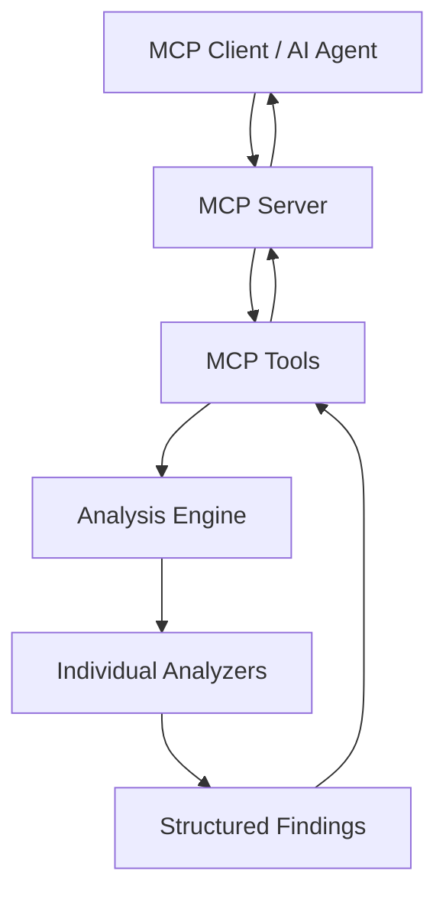

# ai-backend-performance-mcp

Static analysis MCP server for Node.js backend performance issues. AI agents can inspect a project for database query anti-patterns, async bottlenecks, connection pooling mistakes, and dependency hygiene problems — without modifying your code.

## Why this project?

Backend performance issues often hide in plain sight: N+1 queries in loops, clients created per request, sequential awaits that could run in parallel, or dependencies misclassified in `package.json`. This MCP server exposes those patterns as structured, evidence-backed findings that AI coding assistants can reason about.

**What it does**

- Read-only static analysis of JavaScript/TypeScript source files
- Six focused MCP tools for common backend performance categories
- Structured findings with severity, confidence, code snippets, and recommendations
- Distinguishes **confirmed** evidence from **potential** issues

**What it does not do**

- Execute your application or repository code
- Modify files, install packages, or change indexes
- Replace profiling, load testing, or database `EXPLAIN` analysis

## Architecture



See [docs/architecture.md](docs/architecture.md) for layer details.

## Analyzers

| Analyzer | Detects |
|----------|---------|
| Database queries | N+1 patterns, unbounded finds/queries |
| MongoDB indexes | Filter/sort fields without matching `createIndex` |
| Async patterns | `await` in loops, sequential awaits, blocking sync ops |
| Connection pooling | Client/pool creation in handlers or loops |
| Dependencies | Unused deps, dev/prod misclassification, duplicate lockfile versions |
| Redis | `KEYS`, writes without TTL, clients created in handlers, commands in loops |
| ORM | Prisma and TypeORM N+1 reads and list queries without `take` / `limit` |

## MCP Tools

| Tool | Description |
|------|-------------|
| `analyze_project` | Full scan with grouped findings and summary |
| `analyze_database_queries` | MongoDB/PostgreSQL query patterns |
| `analyze_indexes` | MongoDB index coverage heuristics |
| `analyze_async_patterns` | Async/await performance patterns |
| `analyze_connection_pooling` | Connection lifecycle anti-patterns |
| `analyze_dependencies` | `package.json` / lockfile hygiene |
| `investigate_performance` | Full scan plus code-path context, related findings, clusters, and inspect-next hints |
| `explain_performance` | Retrieves rule cards and findings, then answers from those passages. Uses an LLM only when configured |
| `export_report` | Same scan as JSON or SARIF 2.1.0. Does not write a file |

Tool reference: [docs/tools.md](docs/tools.md)

## Installation

**Local (primary until the package is on npm):** clone, install, and build. `npm install` runs `prepare`, which compiles `dist/`.

```bash
git clone https://github.com/robinafaruqia/ai-backend-performance-mcp.git
cd ai-backend-performance-mcp
npm install
```

Then start the server over stdio:

```bash
node dist/index.js
```

**After npm publish:**

```bash
npx -y ai-backend-performance-mcp
```

## MCP configuration

Use a local build in Cursor (or Claude Desktop) first. Replace the path with the absolute path to this repo:

```json
{
  "mcpServers": {
    "backend-performance": {
      "command": "node",
      "args": ["/absolute/path/to/ai-backend-performance-mcp/dist/index.js"]
    }
  }
}
```

After the package is published to npm:

```json
{
  "mcpServers": {
    "backend-performance": {
      "command": "npx",
      "args": ["-y", "ai-backend-performance-mcp"]
    }
  }
}
```

## Usage

Invoke any tool with a `projectPath` pointing to a Node.js backend repository:

```json
{
  "projectPath": "/path/to/your/api"
}
```

### Example output (truncated)

```json
{
  "projectPath": "/app/examples/sample-node-api",
  "technologies": ["express", "mongodb"],
  "metadata": {
    "packageName": "sample-node-api",
    "packageVersion": "1.0.0",
    "sourceFileCount": 4
  },
  "findings": [
    {
      "category": "pooling",
      "severity": "critical",
      "title": "Connection or client created in request handler",
      "evidence": {
        "kind": "confirmed",
        "snippet": "const client = await MongoClient.connect(...)"
      },
      "confidence": 0.9,
      "recommendation": "Create a shared client/pool at module scope and reuse it."
    }
  ],
  "summary": {
    "totalFindings": 6,
    "confirmedCount": 3,
    "potentialCount": 3
  }
}
```

Try the included demo project at [examples/sample-node-api](examples/sample-node-api).

## Safety

- **Read-only**: never writes to analyzed projects
- **Path validation**: prevents traversal outside `projectPath`
- **No code execution**: parses source text only; does not run repository code
- **Untrusted input**: treat analyzed repos as untrusted

## Limitations

- Static analysis only; findings that depend on cluster state stay `potential`
- Dynamic `require()` / runtime-generated queries are not fully tracked
- Index analysis compares in-repo `createIndex` key order and sort direction only (not Atlas/ops-managed indexes). It stays silent when the repo defines none, or when a key spec is dynamic, and every index finding stays potential
- `Array.find`, batched `$in`/`ANY()`, `_id` lookups, and module-scope DB clients are not treated as issues
- Sequential awaits are flagged only when they do not consume prior bindings; `Promise.all` is never reported as a finding
- Dependency unused detection is import-scan based
- Redis, Prisma, and TypeORM rules are syntactic. They do not measure latency or see a later `EXPIRE` / `take` passed through a variable
- `explain_performance` sends only retrieved passages to a model. With no `PERFORMANCE_MCP_LLM_BASE_URL` and `PERFORMANCE_MCP_LLM_API_KEY`, the answer is assembled from those passages and no model is called

## Development

```bash
git clone https://github.com/robinafaruqia/ai-backend-performance-mcp.git
cd ai-backend-performance-mcp
npm install
npm run typecheck
npm run lint
npm test
npm run build
```

See [docs/development.md](docs/development.md).

## Testing

```bash
npm test
```

Fixture projects under `tests/fixtures/` pair **problematic** and **valid** code for N+1 queries, indexes, async, pooling, and dependencies so analyzers do not fire on every await, query, loop, or connection.

## Retrieval and LLM

`explain_performance` is retrieval-augmented:

1. Analyzers produce findings.
2. A lexical index ranks those findings plus the built-in rule cards for the question.
3. If `PERFORMANCE_MCP_LLM_BASE_URL` and `PERFORMANCE_MCP_LLM_API_KEY` are set, an OpenAI-compatible chat completion sees only those passages. Otherwise the tool returns a retrieved-only answer.

Optional `PERFORMANCE_MCP_LLM_MODEL` (default `gpt-4o-mini`). Every analysis tool accepts `minSeverity` (`info`, `low`, `medium`, `high`, `critical`).

Repository text inside a passage is untrusted. The system prompt tells the model to ignore instructions found there.

## Roadmap

- [x] Redis/cache analyzer
- [x] Prisma/TypeORM-specific query rules
- [x] ProjectContext caching
- [x] SARIF/JSON report export
- [x] Configurable severity thresholds

## Contributing

Contributions are welcome! See [CONTRIBUTING.md](CONTRIBUTING.md) and [CODE_OF_CONDUCT.md](CODE_OF_CONDUCT.md).

## License

MIT — see [LICENSE](LICENSE).
